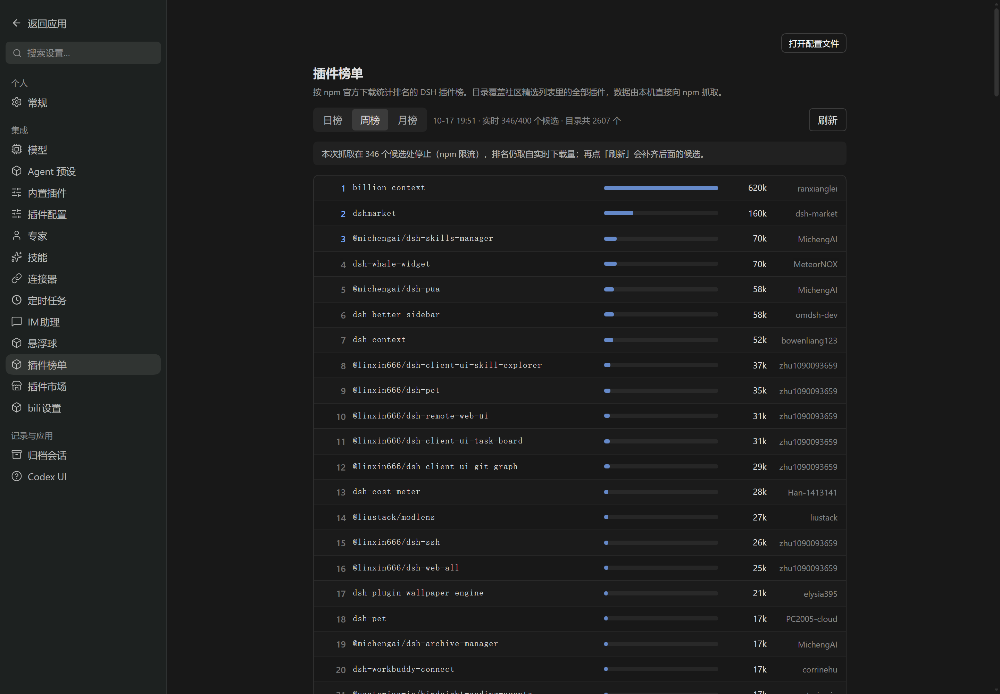

# dsh-rank-board

> 在 DeepSeek Harness 里直接看 DSH 插件榜单：按 npm 真实下载量排名，日榜 / 周榜 / 月榜随时切换。

`dsh-rank-board` 是一个 Cordis 插件（宿主端 + Web 客户端两半）：宿主拉取社区插件目录 [awesome-dsh-plugin](https://awesome-dsh-plugin.com/)，向 npm 官方 API 查询下载量并缓存，客户端把结果渲染在「设置 → 插件榜单」里。



_「设置 → 插件榜单」的实际界面：日榜 / 周榜 / 月榜切换，顶部显示抓取进度与限流提示。_

## 功能

- **日榜 / 周榜 / 月榜**：同一批候选，按 `last-day`、`last-week`、`last-month` 三个口径分别排名。
- **本机直连 npm**：抓取在宿主进程里完成，绕开浏览器 CORS，也不让页面等待几百个请求。
- **进度可见**：抓取时显示进度条与百分比，结果分批落地，不必等全部完成才看到榜单。
- **限流降级**：npm 返回 429 时先展示社区目录自带的 30 天下载量，并在页面顶部明确标注「不是实时数据」。
- **落盘缓存**：榜单缓存 6 小时，单包下载量缓存 24 小时。重启 DSH 后榜单仍在，第二次刷新通常几秒完成。
- **一键复制安装命令**：点击任意一行，复制该插件在目录里的安装命令（含正确的 profile 参数）。
- **空窗口自动抓取**：第一次切到某个窗口时自动开抓，不用手动点「刷新」。

## 安装

前置条件：使用 DSH 的 Web / Desktop 界面（插件挂在 Web 设置页），宿主 Node.js ≥ 20。

插件通过 GitHub Release 分发（暂未发布到 npm）。

### 方式一：GitHub Release（推荐）

从 [Releases](https://github.com/flysusdjd/dsh-rank-board/releases) 复制对应版本的 `.tgz` 链接：

```bash
dsh plugin --profile desktop add "https://github.com/flysusdjd/dsh-rank-board/releases/download/v0.1.0/dsh-rank-board-0.1.0.tgz"
```

`--profile` 换成你实际使用的 profile（`desktop` 或 `web`）。社区目录同样支持这种 tarball 安装方式，不需要 npm 账号。

### 方式二：本地源码

```bash
git clone https://github.com/flysusdjd/dsh-rank-board.git
dsh plugin --profile desktop add "link:$PWD/dsh-rank-board"
```

安装后重启 DSH（或重新加载 profile），打开「设置 → 插件榜单」。首次打开会自动开抓，也可以点「刷新」。

## 数据口径与已知限制

- **下载量 ≠ 用户数**：数字是 npm 统计的 tarball 下载次数，包含 CI、镜像同步、批量安装等，不等于真实使用者数量。
- **只覆盖有 npm 包名的插件**：目录里 5,700+ 个条目中约 2,600 个带 npm 包名；另外 3,000+ 个只提供 tarball 的插件不会上这个榜。
- **候选池是前 400 名**：npm 批量接口一次最多 128 个包，且拒绝 `@scope/name`。为控制请求量，只对「目录自带 30 天下载量」最高的 400 个候选做实时查询；scoped 包逐个查，整体受 120 秒截止时间约束。
- **部分数据是正常的**：截止时间或限流会留下 `partial: true`，页面会提示再刷新补齐；已抓到的单包计数会复用，所以多次刷新会逐步收敛。
- **社区目录是唯一数据源**：未收录进 awesome-dsh-plugin 的插件不会出现。

## 工作原理

```
┌────────────────────────────┐        ┌──────────────────────────────┐
│ 浏览器（client.js）        │  GET   │ 宿主（lib/index.js）         │
│ 设置 → 插件榜单            │ ─────► │ GET /.dsh-rank-board/board   │
│ 轮询进度 / 点击刷新        │ ◄───── │ POST /.dsh-rank-board/refresh│
└────────────────────────────┘  JSON  └──────────────┬───────────────┘
                                                     │ 每 6 小时 / 手动
                                                     ▼
                                      ┌──────────────────────────────┐
                                      │ awesome-dsh-plugin 目录       │
                                      │ npm downloads point API      │
                                      └──────────────────────────────┘
                                                     │
                                                     ▼
                                      <profile>/.dsh-rank-board/*.json
```

宿主端负责目录抓取、批量 / 逐个查询、限流重试、截止时间控制、结果合并与缓存；客户端只读本机接口，不直接访问 npm，也不持有任何密钥。

### HTTP 接口（仅监听本机 Web 端口）

| 方法 | 路径 | 说明 |
| --- | --- | --- |
| `GET` | `/.dsh-rank-board/board?window=last-day\|last-week\|last-month` | 返回当前榜单与抓取进度 |
| `POST` | `/.dsh-rank-board/refresh?window=...` | 触发一次后台抓取，立即返回 `202` |

响应形如：

```json
{
  "ok": true,
  "window": "last-week",
  "updatedAt": "2026-10-17T11:51:19.138Z",
  "candidates": 2607,
  "shortlist": 400,
  "resolved": 346,
  "unresolved": 54,
  "basis": "live",
  "partial": true,
  "rows": [{ "name": "billion-context", "owner": "ranxianglei", "downloads": 619804, "install": "…" }],
  "progress": { "running": false, "phase": "done", "done": 346, "total": 400, "error": "" }
}
```

`basis` 为 `live`（实时下载量）、`catalog`（限流降级，目录自带 30 天数据）或 `none`（尚无缓存）。

## 配置

默认开启「冷启动 / 过期时后台自动补抓」。关闭方式：在 profile 的 `cordis.patch.yml` 里覆盖该条目：

```yaml
- id: dsh-rank-board
  name: dsh-rank-board
  config:
    autoRefresh: false
```

关闭后只能通过界面的「刷新」按钮触发抓取。

## 开发

```bash
git clone https://github.com/flysusdjd/dsh-rank-board.git
cd dsh-rank-board
npm test          # node:test：宿主契约、HTTP 路由、目录抓取（mock fetch）、客户端注册
npm run check     # 两个入口的语法检查
```

把源码挂进一个 profile 调试：

```bash
dsh plugin --profile desktop add "link:/absolute/path/to/dsh-rank-board"
```

缓存目录：`<profile>/.dsh-rank-board/`（`board-*.json` 是榜单，`counts-*.json` 是单包计数）。删掉即可强制冷启动。

### 目录结构

```
dsh-rank-board/
├── lib/index.js          # 宿主端：目录 / npm 抓取、缓存、HTTP 路由
├── client.js             # Web 客户端：设置页里的榜单组件（无构建步骤）
├── cordis.patch.yml      # 把插件插入 profile 的 bundle patch
├── test/plugin.test.js   # 冒烟与抓取流程测试
├── package.json
└── .github/workflows/ci.yml
```

客户端是 DSH 的模块加载脚本（`window.__ModuleLoader__.load`），不是 ES module，也不经过打包器；改动后重新加载页面即可。宿主端与客户端通过 `/.dsh-rank-board/*` 通信。

## 许可证

[MIT](LICENSE)。与 DeepSeek、npm、awesome-dsh-plugin 均无官方关联。

---

**English**: `dsh-rank-board` is a Cordis plugin for DeepSeek Harness that ranks community plugins by real npm download counts (daily / weekly / monthly), rendered as a settings section. The host process crawls the awesome-dsh-plugin catalog and npm, caches boards on disk, and serves them on the local web port; the browser never calls npm directly. Install via the release tarball or from source, restart DSH, then open Settings → 插件榜单.
